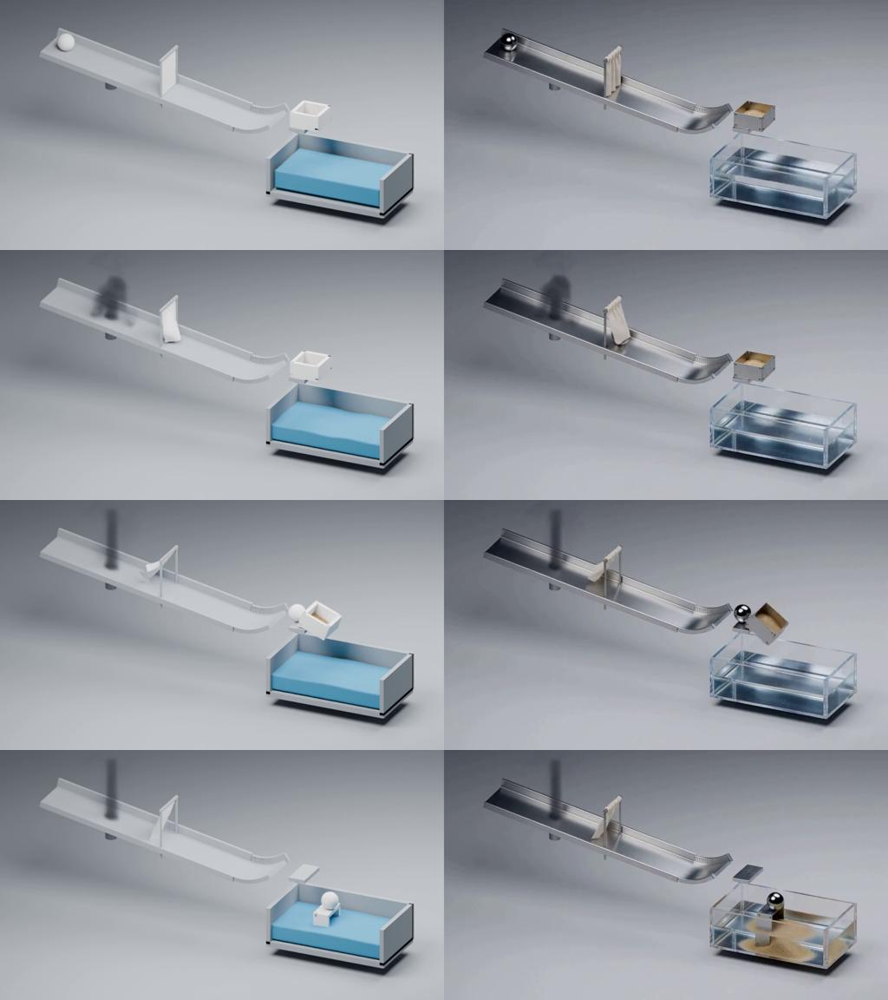
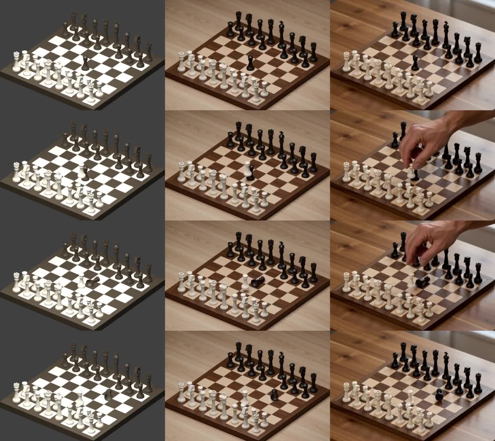
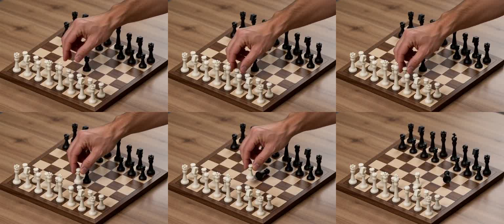

# Physics Video Harness

模拟器生成物理草稿，再以冻结 MiniMax H3 Ref2VA 生成写实视频。组合实验快照：2026-11-11；棋盘实验更新：2026-11-14。这里归档选型、实际运行代码和最终结果，不包含模型权重或失败调参视频。

## 最终结果

| 场景 | 白模 | H3 成片 | 同步对照 |
|---|---|---|---|
| 完整组合：烟雾、布帘、起跳、撞装沙托盘、落水 | [视频](results/combined/complete.mp4) | [视频](results/combined/h3/final_retry_seed0.mp4) | [左白模／右H3](results/combined/h3/comparison.mp4) |
| 液体 | [视频](results/liquid/draft.mp4) | [视频](results/liquid/final_seed0.mp4) | [对照](results/liquid/comparison.mp4) |
| 布料 | [视频](results/cloth/draft.mp4) | [视频](results/cloth/final_seed0.mp4) | [对照](results/cloth/comparison.mp4) |
| 小球滚向沙堆 | [视频](results/sand/draft.mp4) | [视频](results/sand/final_seed0.mp4) | [对照](results/sand/comparison.mp4) |

[](results/combined/h3/comparison.mp4)

## 棋盘碰撞与 H3 补手实验（2026-11-14）

白兵抬起、前进并意外碰倒前方黑兵，随后退回放下。MuJoCo 计算棋子运动，Blender 渲染无手参考视频，冻结 H3 Ref2VA 根据文字补手并转换材质。没有训练新模型。

| 版本 | 视频 | 观察与限制 |
|---|---|---|
| 物理参考，无手 | [白模](results/chess/draft.mp4) | 白兵由有限柔顺 weld 跟随外部目标，3.6 秒释放；黑兵为接触驱动自由刚体，无倒下关键帧 |
| 仅改材质 | [成片](results/chess/materials_only.mp4) | 保留整体棋盘构图，但局部棋子混淆；黑兵中间倒下、末尾出现重新立起错误 |
| 改材质并补手 | [成片](results/chess/with_hand.mp4) | 手出现晚于白兵起始运动，抓握处存在棋子身份混淆 |
| 最新：首帧补手指令 | [成片](results/chess/with_hand_early.mp4) | 首帧已有手，但尚未明确抓牢目标白兵；仍有接近抓取过程，手臂方向也未可靠遵守白方侧要求 |

[三列同步对照：左白模／中仅改材质／右补手](results/chess/comparison.mp4)。三列按相同帧号并排，不插帧、不做时间拉伸，也不对棋盘额外配准。最新首帧补手版单独列出，不在三列视频中。

[](results/chess/comparison.mp4)

[](results/chess/with_hand_early.mp4)

各版均为 768×512、124 帧、24 fps、seed 0、20 调度点（19 次显示去噪迭代）。两版对照使用相同白模与种子；最新补手版仅修改抓握时序指令。各版精确结构化提示词和运行记录见 `results/chess/*.txt`、`*.json`。

去除早期提示词中的 `close-up` 并加强构图保持要求后，整体构图较早期近景结果改善；两项同时修改，不能单独归因于某一句提示词。仅材质版仍出现状态错误，说明问题并不完全来自补手。所有结论来自少数案例和关键帧检查，不构成定量控制精度评测。

实际求解与渲染代码在 [simulate.py](results/chess/simulate.py)、[render.py](results/chess/render.py)，附场景、状态和渲染数据。棋子为程序化旋转体与简化装饰，碰撞使用圆柱、胶囊和球代理，不是精细生成资产。白兵运动受外部目标驱动，不是完整手—棋子动力学。

复现顺序（需要 MuJoCo、NumPy、Blender 与 H3 环境，修改模型路径）：

```bash
python results/chess/simulate.py
blender -b --python results/chess/render.py
ffmpeg -framerate 24 -i results/chess/frames/%04d.png -c:v libx264 -pix_fmt yuv420p results/chess/draft.mp4
python physics_harness/infer_h3.py --model /path/to/MiniMax-H3 --draft results/chess/draft.mp4 --output /tmp/chess_hand.mp4 --caption-file results/chess/with_hand_early.txt --prompt "Hand already grasping white pawn before lift" --height 512 --width 768 --steps 20 --seed 0
```

Ref2VA 将参考视频经 VAE 编码、patchify 后与目标视频 tokens 沿序列拼接，通过联合 self-attention 读取参考；不是逐像素锁定。参考与目标使用同一空间 RoPE 规则，网格相同时 h/w 坐标对齐，但时间区间前后排列。空间 PE 对齐不保证棋子身份、轨迹和相机严格保持。当前脚本没有局部 mask 编辑或额外结构控制分支。

## 模拟器选型与职责

| 现象 | 实际使用 | 职责 |
|---|---|---|
| 刚体、沙子、动态托盘 | NVIDIA Newton 1.7 / XPBD + implicit MPM | 刚体碰撞与材料点求解，保留冲量交换；MPM 材料点不是逐粒 DEM |
| 布料 | BS-Cloth / B-spline FEM + IPC | 原生求解固定边布帘与运动球碰撞；适配补丁随代码归档 |
| 液体 | SPlisHSPlasH 2.19.1 / DFSPH | 水槽和由球轨迹驱动的运动边界 |
| 液面 | splashsurf 0.14.1.0 | 流体粒子表面重建，不是额外流体求解器 |
| 烟雾 | Blender Mantaflow | 烟雾模拟与逐帧 VDB |
| 统一渲染 | Blender 4.5.3 / Cycles CUDA | 保持各求解器坐标与 24 fps 时间轴 |
| 写实生成 | MiniMax H3 Ref2VA | 冻结权重、seed 0、20 调度点／19 次去噪 |

组合 H3 输出 1024×576、124 帧、24 fps。对照将白模等比例缩小后并排，无插帧或时间拉伸。独立案例配置有所不同，应分别看对应检查与 caption。

## 运行代码

代码位于 `physics_harness/`。这是已执行实验代码的整理快照，尚非任意机器一键安装的产品；需要安装模拟器、编译 BS-Cloth，并修改本地模型路径。没有重新运行整套重计算，只做发布静态检查。

完整组合的实际顺序：

1. `chain/check_tray_settle.py`：求解球、托盘与沙子（基于 `solve_tray_no_overlap.py`）。
2. `chain/run_specialist.py`：在已有 `rigid.npz` 上求解 BS-Cloth、DFSPH、Mantaflow。
3. `chain/render_tray_complete.py`：统一渲染全部组分。
4. `infer_h3.py`：读完整白模和 `results/combined/h3/caption.txt`，执行 Ref2VA。

已执行刚体配置示例：

```bash
python physics_harness/chain/check_tray_settle.py --output outputs/combined --frames 124 --settle 24 --sand-start 2.20 --sand-end 2.60 --sand-thickness .05 --sand-half-width .20 --particle-spacing .0125 --voxel .0125 --sand-friction .65 --mpm-substeps 20 --grid-type sparse
python physics_harness/chain/run_specialist.py --output outputs/combined
blender -b --python physics_harness/chain/render_tray_complete.py -- outputs/combined --water --start 0 --end 124
```

DFSPH 使用的 Python wheel 在实验环境需要 `LD_PRELOAD=/usr/lib/x86_64-linux-gnu/libGLdispatch.so.0`。Warp 使用 1.17.0 CUDA12 wheel；不能直接假设其他 CUDA wheel 与驱动兼容。BS-Cloth 源码放在 `upstream/BS-Cloth-headless`，应用 `chain/bscloth_adapter.patch` 后编译，详见 [依赖与来源](THIRD_PARTY.md)。

## 当前限制

- 组合场景撞前记录零穿底、零侧漏；撞后仍有少量材料点低于底板。零计数是采样检查，不是连续无穿透证明。
- 只有刚体—MPM 保留冲量交换；布料、烟雾、水体单向接收球轨迹，无力反馈。
- 托盘和沙子未接入液体边界，未实现完整沙水双向耦合。
- H3 改变局部形状、材质和运动，不保证逐像素对齐或物理准确性。
- 所有结果为少数案例的初步验证；没有训练新模型或证明泛化性能。

本仓库未统一重授权：第三方代码按原许可证使用，模型权重需自行获取并遵守其许可。
